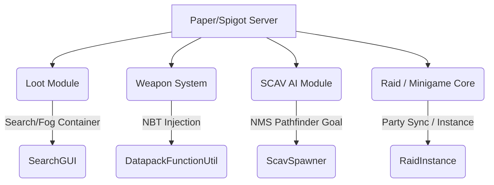

# ImpossbleEscapeMC

<p align="center">
  
  
  
</p>

---

**ImpossbleEscapeMC** is a tactical survival extraction expansion designed for Paper Minecraft servers (1.21.x). It transforms the vanilla survival loop into an intense Escape-from-Tarkov-like experience centering on **Looting**, **Engaging**, and **Extracting**.

Featuring advanced SCAV AI, custom client-server synchronized guns via datapack NBT, deep armor and medical pipelines, and integrated lobby minigames.

---

## 🌟 Key Features

### 🔫 Advanced Weaponry
- **NMS Custom Guns**: Fully server-side generated guns using datapack-compatible NBT components, removing client-side mod requirements.
- **Realistic Gunplay**: Interactive attachments, reload/bolt actions, custom caliber ammo pools, dynamic recoil, and spray patterns.
- **Attachment GUI**: Customize sights, scopes, and grips in real-time.

### 🧠 Intelligent SCAV AI
- **Sensory Behavior**: Visual and auditory search patterns. Enemies react to footsteps, gunshots, and flashlight movements.
- **Tactical Positioning**: Smart use of cover, tactical retreating, squad coordination, and distinct situational voice lines.
- **Spawning Heatmaps**: Dynamic heatmap visualizations to inspect and adjust spawn densities across maps.

### 🎒 Core Mechanics & Looting
- **Search GUI**: Containers and dead players (corpses) must be searched incrementally, revealing items slot-by-slot under a foggy layout.
- **FIR System (Found in Raid)**: Status tracking for looted items to restrict trader listings and auction markets.
- **Armor & Medical Pipelines**: Functional helmets and chest plates with varying armor classes, alongside complex medical kits to treat specific wounds.

### ⚔️ Raid & Party Loop
- **Instance Management**: Lobby queueing, spawn selection, party chat, and extraction zones.
- **Minigame Engine**: Team splits, rounds, loadout selectors, and respawn mechanisms.

---

## ⚙️ Quick Start

### For Server Administrators

1. **Requirements**: Download and run a **Paper 1.21.x** server with **Java 25**.
2. **Installation**:
   - Place the compiled plugin `.jar` in the `plugins/` directory.
   - Start the server once to generate configuration files, then stop it.
   - Configure definitions in `plugins/ImpossbleEscapeMC/` for loot pools (`loot.yml`), items (`items.yml`), and traders (`traders.yml`).
3. **Run**: Start the server and enjoy!

### For Developers

1. **Clone the Repository**:
   ```bash
   git clone https://github.com/RuskServer/ImpossbleEscapeMC.git
   cd ImpossbleEscapeMC
   ```
2. **Build with Maven**:
   ```bash
   mvn clean package
   ```
   The compiled jar will be available in the `target/` directory.

---

## 💻 Commands Cheatsheet

| Command | Description | Permission |
| :--- | :--- | :--- |
| `/getitem <itemId> [amount]` | Acquire specific custom items. | `impossbleescapemc.getitem` |
| `/attachment` | Open attachments editor GUI for the held gun. | *None (All Players)* |
| `/iemmessages reload` | Validate and reload server-side message translations. | `iem.messages.admin` (op) |
| `/itemreload` | Reload custom items, configurations, and trader files. | `op` |
| `/scavspawn [low\|mid\|high] [x y z]` | Spawn a SCAV with an explicit AI level; omission retains the LOW/MID roll. Legacy coordinates and trailing level are supported. Use `heatmap` to toggle spawn map; `corpsecheck` reports nearby corpse interaction state without bypassing protection. `inspect` reports the aimed SCAV’s actual role, rank, alertness and equipment. | `op` |
| `/raid <join\|leave\|start\|extract\|scavspawn>` | Complete raid queueing and map interactions. | `op` |
| `/raid danger <add\|list\|remove> <mapID> [zoneID] [name]` | Manage high-threat cuboids selected with WorldEdit/FAWE. | `op` |
| `/raid boss <add\|list\|remove> <mapID> [zoneID / pointID] [boss-id]` | Register multiple leader spawn candidates per map, with automatic guard placement; see [boss setup](docs/RAID_BOSS.md). | `op` |
| `/raid radio preview <zone\|item\|boss>` | Preview radio while participating in a raid. | `op` |
| `/party <create\|invite\|accept\|leave\|kick\|info\|chat>` | Squad management and secure communication. | *None (All Players)* |
| `/loot <container\|drawer\|locker\|egg\|draweregg\|lockeregg\|groundegg\|remover\|refill>` | Place, remove and refill loot crates and ground loot spots. | `op` |
| `/loot draweregg <mapId> <crateId>` | Get a reusable egg to place animated loot drawers by right-clicking a block face. | `op` |
| `/loot lockeregg <mapId>` | Get a reusable egg for animated lockers with a 25% loot chance. | `op` |
| `/loot locker <place\|remove\|list>` | Place lockers with random standard/medical/ammo loot; see [LOCKER_LOOT.md](docs/LOCKER_LOOT.md). | `op` |
| `/loot drawer <place\|remove\|list>` | Place animated two-drawer loot furniture; see [DRAWER_LOOT.md](docs/DRAWER_LOOT.md). | `op` |
| `/trader <open\|reload> [traderId]` | Shop from local traders or reload traders layout. | `op` / `impossbleescapemc.trader.reload` |
| `/mg <create\|setspawn\|split\|start\|stop\|loadout>` | Manage active minigame lobby parameters. | `op` |

---

`messages.default-language` selects the fallback message language (default: `ja_jp`). Notifications use the shared API and server-side `lang/*.json`; see [MESSAGE_API.md](docs/MESSAGE_API.md) for events, translation keys and reload behavior.

`raid-radio.enabled` in `config.yml` enables boss-intel, threat-entry and quest-item discovery radio (default: `true`). See [RAID_RADIO.md](docs/RAID_RADIO.md) for selection, cooldowns and resource-pack requirements.

`scav-ragdoll.enabled` enables animated SCAV corpses (default: `true`); `scav-ragdoll.debug` logs creation and skip reasons (default: `false`). Update the resource pack together; see [SCAV_RAGDOLL.md](docs/SCAV_RAGDOLL.md) for supported equipment, limits and verification.

## 🏗️ System Architecture

Constructor injection, annotated component discovery and dependency-ordered lifecycle management share the existing `ServiceContainer`. `Supplier<T>` supports runtime back-references without constructor cycles. Legacy module order is preserved; startup failures roll back started components. See [DEPENDENCY_INJECTION.md](docs/DEPENDENCY_INJECTION.md). Set `di.debug: true` to log dependency and startup-order information.




---

## 📄 License

This project is licensed under the **AGPLv3 License**. See the [LICENSE](LICENSE) file for more information.

### 食料

`beef_can`（牛肉缶）は右クリックを3秒間長押しして食べる。空腹度を8（上限20）、満腹度を8回復し、1個を消費する。満腹時には使用できず、途中で持ち替える・使用をやめると中断する。重量350g、サイズ1、レアリティ2。見た目にはリソースパックの鉄インゴット CustomModelData 28 を使用する。

通常物資の `common_pool` に35%で登録。Pharmakonで1,800₽、Brokerへの売却は600₽。体力やスタミナを直接回復する効果はなく、空腹度による既存のスタミナ回復率に反映される。

### 救急キット

AI-2とIFAKは、右クリックを押し続けると0.5秒ごとに2 HPを回復し、耐久を2消費する。AI-2の最大耐久は25、IFAKは120。どちらも重量100g・サイズ1で、回復量・使用間隔・耐久節約の医療スキルが適用される。出血・骨折の治療は含まない。既存のAI-2も使用・説明更新時に最大耐久25へ収める。

IFAK（`ifak`、鉄インゴット CustomModelData 29）はPharmakon最終タスク「長期活動の備蓄」完了で販売解放。価格11,500₽、1日10個まで。Brokerへの売却は6,000₽、医療品の `medical_pool` に15%で登録。IFAK専用のポーチ開閉・包装・処置音を使用するため、リソースパックも更新する。
