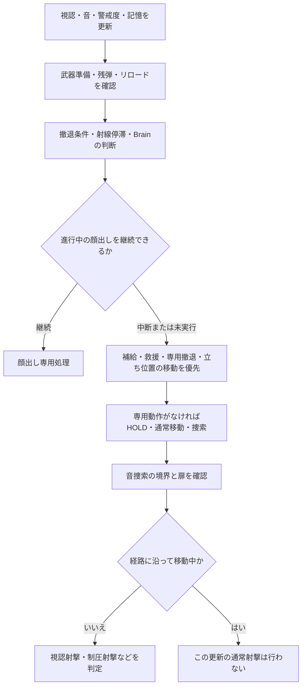

# SCAV AI 技術仕様書

更新日: 2026-10-29。照合対象: `74309c7` 時点のプラグイン実装。

この文書は、SCAVが何を手がかりに敵を探し、どう移動・射撃・撤退を選ぶかを説明する。設計案ではなく、現在のコードの仕様を記載する。数値は設定ファイルに記載したものを除きJava定数で、秒への換算は20TPSを前提とする。

SCAVはUtilityによる戦術選択、明示的な条件分岐、位置候補の採点、過去の観測からの位置推定を組み合わせる。`getNeuronStates()` という名前はあるが、実行中にニューラルネットワークを学習させる仕組みではない。`ScavBrain.reward()` などの互換メソッドも現在は空実装である。

## 目次

1. [構成と更新周期](#1-構成と更新周期)
2. [状態と行動の区別](#2-状態と行動の区別)
3. [通常時の巡回と警戒度](#3-通常時の巡回と警戒度)
4. [視認と暗所](#4-視認と暗所)
5. [銃声・足音・被弾](#5-銃声足音被弾)
6. [見失った敵の記憶と捜索](#6-見失った敵の記憶と捜索)
7. [Brainの戦術選択と安定化](#7-brainの戦術選択と安定化)
8. [立ち位置・移動・顔出し](#8-立ち位置移動顔出し)
9. [撤退と再交戦](#9-撤退と再交戦)
10. [射線がない場所からの回復](#10-射線がない場所からの回復)
11. [射撃・照準・弾薬](#11-射撃照準弾薬)
12. [分隊・援護・捜索分担](#12-分隊援護捜索分担)
13. [地形の危険記録とボイス](#13-地形の危険記録とボイス)
14. [設定・ログ・負荷・検証](#14-設定ログ負荷検証)
15. [調整時の読み方と制約](#15-調整時の読み方と制約)

## 1. 構成と更新周期

| 実装 | 責務 |
|---|---|
| [ScavSpawner](../src/main/java/com/lunar_prototype/impossbleEscapeMC/ai/ScavSpawner.java) | 個体生成、装備・Brainランク、Controller登録、AIと照準の定期更新、終了処理 |
| [ScavController](../src/main/java/com/lunar_prototype/impossbleEscapeMC/ai/ScavController.java) | 視認・音・記憶・武器状態の統合、行動の優先順位、照準・射撃・補給・警戒状態 |
| [ScavBrain](../src/main/java/com/lunar_prototype/impossbleEscapeMC/ai/ScavBrain.java) / [CombatEvaluator](../src/main/java/com/lunar_prototype/impossbleEscapeMC/ai/util/CombatEvaluator.java) | 攻撃性・恐怖・戦術性、戦術モードの確率選択、移動と射撃の提案 |
| [ScavVision](../src/main/java/com/lunar_prototype/impossbleEscapeMC/ai/ScavVision.java) | 新規発見と追跡の別判定、明るさ・FOV・9本の遮蔽レイ |
| [OpponentBelief](../src/main/java/com/lunar_prototype/impossbleEscapeMC/ai/OpponentBelief.java) | 見失った敵の位置候補、音による補正、見えていない証拠、出現位置と索敵方向の推定 |
| [ScavTactics](../src/main/java/com/lunar_prototype/impossbleEscapeMC/ai/ScavTactics.java) | 通常の前後・横移動、直接歩行、顔出しと戻り、角の捜索、ジャンプ |
| [TacticalPositioning](../src/main/java/com/lunar_prototype/impossbleEscapeMC/ai/TacticalPositioning.java) | 撃てる位置・顔出し可能な遮蔽・隠れる位置の採点と選択 |
| [ScavWithdrawal](../src/main/java/com/lunar_prototype/impossbleEscapeMC/ai/ScavWithdrawal.java) / [WithdrawalRouteCost](../src/main/java/com/lunar_prototype/impossbleEscapeMC/ai/WithdrawalRouteCost.java) | 撤退専用の候補・経路評価、進捗監視、失敗先の一時除外 |
| [ScavDecisionStability](../src/main/java/com/lunar_prototype/impossbleEscapeMC/ai/ScavDecisionStability.java) / [ScavSightRecovery](../src/main/java/com/lunar_prototype/impossbleEscapeMC/ai/ScavSightRecovery.java) | 制圧のヒステリシス・通常移動の保持、射線も移動進展もない場合の回復 |
| [ScavSquad](../src/main/java/com/lunar_prototype/impossbleEscapeMC/ai/ScavSquad.java) / [ScavHelpEncounter](../src/main/java/com/lunar_prototype/impossbleEscapeMC/ai/ScavHelpEncounter.java) | 前衛・援護役、援護要請、交戦単位の人数管理 |
| [ScavContactReport](../src/main/java/com/lunar_prototype/impossbleEscapeMC/ai/ScavContactReport.java) / [ScavSearchPlan](../src/main/java/com/lunar_prototype/impossbleEscapeMC/ai/ScavSearchPlan.java) | 過去の視認報告、救援者の左右配置、重複しない捜索地点の予約 |
| [ScavWeapon](../src/main/java/com/lunar_prototype/impossbleEscapeMC/ai/weapon/ScavWeapon.java) / [DatapackScavWeapon](../src/main/java/com/lunar_prototype/impossbleEscapeMC/ai/weapon/DatapackScavWeapon.java) | 武器性能・残弾・準備時間の共通窓口とToi's Armory連携 |
| [CombatHeatmapManager](../src/main/java/com/lunar_prototype/impossbleEscapeMC/ai/CombatHeatmapManager.java) / [AiRaidLogger](../src/main/java/com/lunar_prototype/impossbleEscapeMC/ai/AiRaidLogger.java) | 地点の危険・射線・安全の記録、レイド単位の観測ログ |

### 周期と時間の単位

| 処理 | 周期・基準 |
|---|---|
| Controllerの `onTick()` | 3サーバーtickごと。これを本書では「1判断ステップ」と呼ぶ |
| `tickAim()` と直接移動の更新 | 毎サーバーtick |
| 近傍味方・役割更新 | 10判断ステップごと、約1.5秒 |
| データパック銃の発射スコア監視 | 毎サーバーtick |
| 通常立ち位置の再評価 | 原則30tick。被弾・敵の移動などで前倒し |
| 通常移動の最低保持 | 15サーバーtick。緊急割り込み・専用移動は別扱い |
| 発射間隔・反応時間 | `System.currentTimeMillis()` によるms |

`searchTicks`、`presenceTicks`、`pursuitSteps` などには判断ステップ単位のカウンターがある。名前だけを見て「20で1秒」と換算しない。低TPSではtickベースの待機が実時間で長くなる一方、射撃のmsタイマーは同じ割合では延びない。射撃実行の機会自体はAI更新周期にも制限される。

### 生成時の個体

通常抽選はLOW 60%、MID 40%。HIGHの分岐は残るが、通常のランダム生成には含めない。Brainのランク未指定コンストラクターはMIDを使う。生成したMobは大人のZombieで、最大体力40、移動速度属性0.15、FOLLOW_RANGE属性64。移動命令の `1.3` や `1.8` は経路移動の速度引数であり、ブロック毎秒ではない。

## 2. 状態と行動の区別

次のものは別々に存在する。同じ名前に見える「待機」「退避」でも、記録する状態を混同しない。

| 層 | 値・例 | 意味 |
|---|---|---|
| 警戒状態 `BehaviorState` | RELAXED / SUSPICIOUS / COMBAT_READY | 数値 `alertness` から決まる日常的な警戒状態 |
| 接触情報 | target / lastKnownLocation / belief / sharedContact | 現在の対象、最後の既知位置と推定、味方からの観測報告 |
| Brainの `TacticalMode` | WITHDRAW / PUSH / PEEK / FLANK / HOLD | 感情と戦況に基づく戦い方の提案 |
| 立ち位置の採点モード | 上記に加えENGAGE | ENGAGEは遮蔽から撃ち合いへ出直すためのController側の指定。Brainの列挙値ではない |
| 実行中の動作 | 撤退経路、顔出し、補給、救援、捜索など | モードの提案より優先されることがある |
| 最終アクション | 移動番号と射撃番号 | 通常行動の提案。専用経路の移動を完全に表すものではない |

大まかな実行順序は以下。厳密な分岐順は `ScavController.onTick()` を参照する。



## 3. 通常時の巡回と警戒度

初期警戒度はLOW 0.15、MID/HIGH 0.25。値は0〜1に制限する。

| 警戒度 | 状態 |
|---|---|
| 0.30未満 | RELAXED |
| 0.30以上0.65未満 | SUSPICIOUS |
| 0.65以上 | COMBAT_READY |

1判断ステップごとの自然減衰はLOW 0.0025、MID/HIGH 0.0015。`lastKnownLocation` がある間は半分。直接視認で+0.08、被弾で+0.35、正式な救援先への新規割当で+0.20、遠方銃声への警戒で+0.10。足音・近距離銃声の加算は距離や継続音などで変わる。

`isAlerted` は別のフラグであり、COMBAT_READYと同じ意味ではない。また `isInCombat()` は最後の視認・被弾から200tick未満かという短期の交戦判定で、警戒度が高いだけでは真にならない。

敵・既知位置・救援先がないRELAXED個体はホーム周辺を巡回する。候補半径4〜14ブロック、ホームから20ブロック超なら帰還を優先する。巡回先は最大8回、足元高さ+2〜-3の範囲で床・頭上・液体を確認して選ぶ。到着後の休止は40〜139tick、経路の再指示は20tick間隔、到達しないまま200tick超ならその地点を諦める。近くにプレイヤーがいる時だけ低確率で独り言を出す。

## 4. 視認と暗所

### 新しく見つける時と追跡中

`scanForTargets()` は同ワールドのSurvival/Adventureプレイヤーを走査し、SCAV用FakePlayerを除外する。新規走査の事前距離上限は96ブロック。リストで最初に条件を満たした相手を返すため、「必ず一番近い敵を選ぶ」仕様ではない。

| 判定 | 新規発見 `checkVision()` | 追跡 `checkTrackingVision()` |
|---|---|---|
| FOV | `100 × (0.8 + 0.25 × alertness)` 度、全幅80〜105度 | FOVでは切らない |
| 対象が直近5tick以内に発砲 | 全幅140度、明るさ倍率を最大1.2倍 | 明るさ倍率を最大1.2倍 |
| 基本距離 | `96 × (0.85 + 0.35 × alertness)` | 同じ |
| 距離への追加補正 | 暗さ、しゃがみ、動き、隠密スキル | 暗さと直近発砲 |
| 明るさ8未満の必要なクリアレイ | 9本中5本 | 9本中3本 |
| 明るさ8以上 | 9本中1本 | 9本中1本 |

基本距離の式だけなら81.6〜115.2ブロックだが、新規走査には上記96ブロックの事前上限がある。追跡でFOVを使わないのは、移動に伴って体が横を向いた瞬間に、見えている敵を失わないためである。

新規発見のFOV外でも4ブロック以内は気配で気付く扱い。しゃがまず水平速度0.1ブロック/tick超で動く対象には、スキル補正前で8ブロックまで広げる。この例外でも暗さによる距離検査と遮蔽レイは必要であり、壁越しに確定発見するものではない。プレイヤーの速度は `getVelocity()` だけに頼らず、5tick以上の位置変化から共有キャッシュで求める。

### 明るさと遮蔽

対象の目の位置のブロック光と、時刻・雨・雷雨で減じた天空光の大きい方を使う。点灯したフラッシュライトを持つ対象は明るさ15として扱う。

| 明るさ | 新規発見距離の倍率 | 追跡距離の倍率 | 通常射撃への暗所拡散加算 |
|---|---|---|---|
| 0〜3 | 0.12 | 0.12 | +0.06 |
| 4〜7 | 0.35 | 0.55 | +0.03 |
| 8〜11 | 0.75 | 1.0 | 0 |
| 12〜15 | 1.0 | 1.0 | 0 |

新規発見では、しゃがみに基本0.6倍、移動速度0.1超に1.2倍、暗所・しゃがみには対応する隠密スキル補正を掛ける。発砲は暗所ペナルティを取り払わず、最終の視認性を1.2倍まで持ち上げるだけ。発砲しても暗所の射撃拡散は消えない。

遮蔽はSCAVの目から、対象の高さ90%・50%・10%それぞれの中央・左右、計9点へ `rayTraceBlocks` を行う。液体を判定せず、通過可能ブロックを無視する設定を使う。立ち位置選択や撤退の遮蔽判定はこれとは別の近似であり、「候補地点からレイが通る」と「現在の対象を実際に視認できる」は同義ではない。

## 5. 銃声・足音・被弾

### データパック銃の発砲通知

[DatapackGunshotWatcher](../src/main/java/com/lunar_prototype/impossbleEscapeMC/listener/DatapackGunshotWatcher.java) が `toisarm.timer.firing` を毎tick監視する。発射信号を検出したら `last_fired_tick` を付けて視認側にも伝える。同じ射手の直近1tick以内の通知を重複抑制する。SCAV用FakePlayerは所有SCAVへ解決し、自分自身への銃声通知は除外する。

通常プレイヤーの銃声には、設定 `scav-hearing` を通知側・受信側の両方で適用する。距離は3次元の直線距離。

| 初期値での距離 | 反応 |
|---|---|
| 32ブロック以内 | SCAV自身と音源が両方ホーム半径40以内なら捜索候補 |
| 32超〜64以内、または内側でもホーム条件を満たさない | 警戒・必要に応じた振り向きのみ |
| 64超 | 無視 |

遠方警戒は1秒に1回まで。敵位置の推定、捜索先、捜索時間を作成・延長しない。味方SCAVの銃声は警戒通知だけで、味方の射撃位置へ敵を探しに行かない。銃のサプレッサー判定は同Watcherに存在するが、現在はマズルフラッシュ用であり、この銃声通知の距離を短縮する処理ではない。

### 音だけの捜索の境界

音だけから始まった捜索は、ホームを中心とする40ブロックの範囲を基準にする。近くの次の音へ切り替わってもホームは動かさない。現在地・誤差付きの推定先だけでなく、経路の残り地点、直接歩行先、顔出し先も確認する。

範囲外なら音の捜索・推定・移動を解除し、必要ならホームへ戻す。再探索の連打を避けるため40tickは新しい音捜索を抑制する。判定は3tick周期なので、押し出しなどで境界を越えてから戻る場合はある。視認・被弾・人数枠を受理した正式な援護には、この音専用の移動境界を適用しない。詳細は [SCAV_HEARING.md](SCAV_HEARING.md)。

### 足音と音の位置誤差

[PlayerListener](../src/main/java/com/lunar_prototype/impossbleEscapeMC/listener/PlayerListener.java) は、しゃがんでいない継続移動を足音通知の候補とする。既定の継続値は歩き40、走り10で、通知間隔は10サーバーtick以上。継続値は移動イベントのカウントであり、すべての状況で厳密な実時間とは限らない。隠密スキルは通知開始までの値や範囲を変える。

通知の近傍検索は基本X/Z±32、Y±16の箱で、スキル・重量で変わる。銃声のような最終的な球距離の検査とは区別する。受信側では、壁越しの足音は12ブロック超なら捨て、音だけのホーム境界も適用する。

位置誤差は水平X/Zへ加える。銃声は距離×0.08（壁越し0.15）、最大8ブロック。足音は距離×0.08（壁越し0.20）、最大6ブロック。1秒以内・約6ブロック以内の反復音は、毎回振り向きやボイスをやり直さず、既存の位置推定を補正する。

銃声、横・背後の足音、走り、十分長い継続音、既に警戒した状態では、音から `lastKnownLocation` を推定する。平常時の短い正面の歩行音は、まず音の地点を調べる動作になることがある。単なる「音が聞こえた」と「射撃対象を視認した」は分離されている。

### 被弾

被弾で警戒度+0.35、制圧値+0.30、直近被弾時刻と危険地点を更新する。Brainへ `DAMAGE_EVENT` を要求し、通常移動の保持と再交戦時間を解除する。

攻撃者を解決できれば、その方向へ振り向き、位置誤差1.5を使った手がかりをbeliefへ加える。対象未設定時は攻撃者とその時点の位置を対象・既知位置として持つ。これは被弾から得る情報であり、新規視認スキャンと同じ入口ではない。

## 6. 見失った敵の記憶と捜索

### 直接視認の記録と追跡

視認中は対象ID、位置、時刻、水平速度を記録する。速度は前回観測との間隔が20tick以内なら更新し、前回値と新しい値を半分ずつ合わせる。別の対象へ切り替わったら前の速度を引き継がない。

見失った最初の判断で、観測済みの速度から20tick先、最大6ブロックを予測する。先に壁があれば壁の手前に留める。通常は予測位置へ最大40判断ステップ、約6秒追跡し、2.5ブロック以内まで来れば慎重な捜索へ切り替える。立ち位置・撤退を既に実行している場合は、この追跡を始めず、その動作を維持する。

対象エンティティの参照を手放す猶予は20判断ステップ、約3秒。参照を手放した後も既知位置の捜索は続くため、これは捜索全体の寿命ではない。見失っている間は別の視認可能な相手への切替も試す。

### 位置候補と「見ていない」証拠

`OpponentBelief` は64個の位置候補を持つ。停止・しゃがみ・歩行・走行を仮定して候補を進め、障害物で進めない時は向きを変える。音は誤差付きの位置手がかりとして候補の重みを更新する。

各更新で最大16候補に視野・遮蔽の検査を行う。見えるはずなのに敵が見えない候補は重みを下げるが、即座に存在確率をゼロにはしない。重みの偏りが強い時は再サンプリングする。最もまとまった推定を `lastKnownLocation` に反映し、遮蔽の端など出てきそうな位置をプリエイム・制圧射撃へ渡す。

捜索の向きもbeliefからの情報利得を16方位で評価できる。最良値の80%以上の方向から選び、60tick維持する。毎判断で最良方向へ首を振り直す方式ではない。

### 捜索をやめる条件

通常捜索は `searchTicks > 600` で既知位置を破棄する。カウンターは1サーバーtickに重複更新しないが、Controller自体が3tick周期なので約90秒相当である。予測位置を追っている早期return中などは、このカウンターが進まない分岐もある。

地点の2.5ブロック以内で確認を60判断ステップ超続けた場合も終了する。撤退・射線回復中は通常捜索による経路の上書きを避けつつ記憶の寿命だけ進める。味方の視認報告の10秒寿命や、交戦判定の200tickとは別のタイマーである。

## 7. Brainの戦術選択と安定化

### 個体差と感情

| ランク | 初期攻撃性 | 初期戦術性 | 選択温度の基準 |
|---|---|---|---|
| LOW | 0.50〜0.80未満 | 0.15〜0.30未満 | 0.22 |
| MID | 0.20〜0.50未満 | 0.30〜0.50未満 | 0.16 |
| HIGH | 0.20〜0.40未満 | 0.50〜0.75未満 | 0.11 |

恐怖の初期値は0.1。選択温度には生成時に0.8〜1.25未満の個体差を掛け、温度が高いほど低得点モードも選びやすい。交戦距離は `武器のpreferredRange × 生成時の個体差0.75〜1.30未満`。視認切れや判断のたびに個体差を引き直さず、武器変更時だけ基準性能が変わる。

視認できない・制圧0.4超・体力40%未満では攻撃性を下げる。近距離で有利なら上げる。恐怖は制圧、体力30%未満、残弾10%未満で増える。恐怖が攻撃性を抑え、攻撃性と戦術性が恐怖を抑える相互作用がある。各値は最後に0〜1へ制限し、生成時の個体性格へ戻す方向に減衰する。

### Utilityと行動番号

戦況の基礎値は `pressure = 制圧×0.4 + (1-自分の体力割合)×0.6`、`advantage = (1-視認対象の体力割合)×0.4 + 残弾割合×0.6`。これらに感情、距離、警戒度、役割を加え、モード別の点数を作る。

| モード | 点数を押し上げる主因 | 通常行動の傾向 |
|---|---|---|
| WITHDRAW | pressure、不利、恐怖 | 後退。制圧中は回避の横移動も提案 |
| PUSH | advantage、攻撃性、近距離、前衛役 | 接近。10ブロック未満ではジャンプも混ぜる |
| PEEK | 敵の存在確信、戦術性、低制圧、援護役 | 近接遮蔽からの顔出し、または横への位置調整 |
| FLANK | 戦術性、低pressure、前衛役 | 交戦距離の0.7〜1.5倍を目安に前後・横へ動く |
| HOLD | 戦術性、低攻撃性、敵の存在確信、援護役 | 視認中は止まって照準を合わせる |

点数の最大値を必ず選ばず、`exp((score-maxScore)/temperature)` の重みで抽選する。直近6回のモード使用回数に応じて1回0.08、最大0.30減点する。一方、同じ移動番号が続いたという理由だけで別の移動へ強制変更する処理は使わない。

移動番号は `0=接近、1=距離維持、2=後退、3/4=横移動、5=ジャンプ、6=顔出し、7=ジャンプ顔出し、8=HOLD`。3/4は番号がそのまま常に左右を固定するわけではなく、Tacticsの横移動区間で方向を決める。射撃番号は `0=射撃を試す、1=撃たない`。実際の発射には後述の武器・視認・時間条件も必要。

### 再評価と割り込み

Brainは視認変化を、発見1判断ステップ・喪失2判断ステップでデバウンスする。Controllerの生の視認判定とは別である。提案した行動の再評価タイマーは視認中1〜2、非視認時3〜5判断ステップ。モードの慣性値は視認中2〜5、非視認時3〜9判断ステップで、維持分岐で減算する。固定の周期ではない。

体力割合が前回から0.10超低下、制圧が0.30超急増、制圧状態への移行、恐怖が0.8を越えるパニック、弾切れの瞬間、視認変化などで割り込む。被弾イベントからも直接再判断を要求する。通常の視認変化より緊急の割り込みを優先する。

制圧状態は生の値0.60以上で開始、0.35以下で解除。間の領域は前の状態を維持する。生の制圧値は平滑化しない。1判断ステップあたり0.02減衰する前にも閾値を確認し、発生直後の閾値越えを取りこぼさない。

Controllerで恐怖・戦術による上書きを行った後の通常移動は15サーバーtick保持する。被弾などの割り込みは保持を無視し、補給・救援・撤退・立ち位置・既存遮蔽移動では保持を破棄する。射撃提案を15tick固定する機能ではない。詳細は [SCAV_DECISION_STABILITY.md](SCAV_DECISION_STABILITY.md)。

## 8. 立ち位置・移動・顔出し

### 立ち位置候補

周囲±8ブロックの2ブロック格子から、立てる位置を探す。格子をワールド座標に固定し、移動で候補が細かくずれないようにする。相手に水平3ブロック未満まで近づく候補と、一時除外した失敗地点を避ける。

| 種類 | 判定・用途 |
|---|---|
| FIRE | その位置の目の高さから既知の敵位置へ射線が通る |
| COVER_PEEK | その場からは見えないが、横±1.5・±2.5の候補へ直接歩いて顔を出せる |
| HIDE | その場で射線が切れ、顔出し候補もない |

採点はモードに応じた種類の得点に、希望距離との差、移動距離、現在地点・選択中地点への維持加点、ヒートマップ、最近の被弾、高所、側面角度、味方との重なりと十字砲火を加減する。味方が制圧射撃中なら移動や露出の減点を軽くする。点数の上位4件までPaperの到達可能な経路を確認する。

原則30tickごと、敵の既知位置が4ブロック超動く、被弾する、地点を無効化する場合などに再評価する。ENGAGEではHIDEを候補にせず、撃てるFIREを優先する。ENGAGEで候補がなければ古い隠れ場所を維持し続けず、通常動作へ戻る。

### 直接歩行と経路移動

到着判定は水平1ブロック以内かつ高さ差0.6未満。一度到着した地点は水平2ブロック以内まで到着扱いを維持する。上下階にいるだけで到着とはみなさない。

相手が見え、目的地が10ブロック以内で直接歩ければ、相手を向いた直接歩行を使う。それ以外は経路で回り込む。ただし、撃てる状態で相手を10ブロック以内に視認している時は、背を向けて回り込む代わりにその場で撃ち合う分岐がある。専用撤退ではこの近接停止を使わない。

経路に沿った移動中は `followingPath` を立て、照準で体の向きを上書きせず、通常射撃も行わない。同じ目的地への有効な経路がある場合は毎判断で作り直さない。直接歩行では毎tick足場と進行可否を確認する。通常の横移動も区間ごとに方向・半径・小休止を選び、区間の途中で無作為に左右を反転させない。

### 顔出しと角の捜索

顔出しは「歩いて出る → 到着して停止・単発射撃 → 元の遮蔽へ戻る → 休止」の専用動作である。候補位置への射線だけでなく、遮蔽位置から直接歩けることを必要とする。候補選定時と動作開始時に、SCAVの実際の目の高さ、および胴の左右0.2ブロックから相手へ向かう射線が、自分から2ブロック以内のブロックで遮られていることを確認する。最大3本の短いレイを使い、遠方の建物・頭が出る低い壁・中心だけを隠す細い柱・未読込チャンクをピークの起点にしない。実行時は予定地点ではなく現在地から再確認し、顔出し先の射線も確認する。開けた場所で視認だけが切れても専用ピークを開始せず、既存の通常戦闘移動・捜索へ進む。出切る前には撃たず、相手が見えないまま時間切れなら空撃ちせず戻る。撃てなくなった時も引き込む。

顔出し後の休止は接敵ありで60〜119tick、空振りでは100〜179tick。Controllerの判断は顔出し中も続き、被弾・弾切れなどの緊急割り込み、リロード退避、射線回復は顔出しを中断できる。静止したまま位置を瞬間移動して出す方式ではない。通常捜索の角確認やジャンプ射撃の補助もTacticsが扱うが、どんな段差・角でも成功することを保証しない。

## 9. 撤退と再交戦

### 撤退へ入る条件

相手への接触がある時、負傷・リロード・BrainのWITHDRAWなどから専用撤退を使う。代表的な強制退避条件は体力40%未満、リロードが必要、撃てるまで20tick以上、視認できず制圧状態にある場合。敵を視認中に制圧されたという理由だけで、常に撃ち返しを止めて走るわけではない。

負傷の退避時間は100tick。制圧による指定は40tick。リロードでは準備完了までの時間+10tickの余裕を考慮し、上限100tickと既存の40tick下限で調整する。実行中の有効な撤退経路は、このモード指定時間が終わっても移動完了まで維持する。

### 候補と経路評価

半径2・4・8・12・16、12方位、高さ±3の範囲から候補を探す。既知の敵位置に対し、候補の胴・頭に相当する高さ1.0/1.6の両方で射線が切れることを遮蔽の基準にする。既に遮蔽に立っていればその場を使える。

遮蔽候補6件と、遮蔽が使えない時の露出した非常用退避2件まで経路を調べる。到達可能な遮蔽がある場合は、露出したまま離れる候補より優先する。実経路を約1ブロック間隔でサンプルし、最初に射線を切るまで、全露出、再露出、経路長、危険マップ、敵へ近づく量、出口が1方向以下の行き止まりを減点する。

評価した経路そのものを移動に使う。4ブロック以内の遮蔽へまっすぐ下がれて相手が見える時だけ直接歩行し、他は経路で小走りに移る。全SCAV合計で同じtickに探索1回まで、1回8経路まで、各経路40ブロックまで。未読込範囲を安全な遮蔽の根拠にしない。

### 中断・選び直しと再交戦

残経路が0.3ブロック超改善しない状態が24tick続く、移動開始失敗、目的地が塞がる・露出する、移動160tick上限に達する場合などに選び直す。失敗した地点は80tick避ける。露出した非常用退避先に着いた場合は、続けて別の遮蔽を探す。使える計画がなければ、射撃や従来の回避動作へ戻って再試行する。

隠れ場所に到着してから、LOW 60〜119、MID 80〜139、HIGH 100〜159tick待つ。再交戦には武器準備完了、マガジン50%以上、体力50%以上、生の制圧0.30以下、被弾から60tick以上、強制退避の期限終了が必要。条件を満たすとENGAGEで60〜119tickの出直しを試みる。出直し中の被弾はこの時間を解除する。

詳細は [SCAV_WITHDRAWAL.md](SCAV_WITHDRAWAL.md)。この判定は現在の単一の既知脅威位置に対する近似であり、すべての敵から同時に安全な遮蔽を保証しない。

## 10. 射線がない場所からの回復

「FIREの候補へ着いたのに撃てない」と「移動も射線も進展しない」は別に検出する。

- FIREに到着して視認できない状態が7判断ステップ続くと、その地点の2ブロック以内を100tick避けて選び直す。移動開始や顔出し開始の実際の失敗も候補破棄の対象。
- 音だけの接触を除き、既知の敵位置があるのに視認できず、0.75ブロック以上の実移動も60tickなければ80tickの回復動作に入る。
- 回復開始時に失敗地点・顔出し・HOLD・通常移動の保持を解除し、ENGAGEで別の射撃位置を探す。候補がなければ最後の既知位置へPaper経路で捜索し、再確認は20tick間隔。
- 再視認、回復期限、保護すべき別動作の発生で解除する。期限後は新たに停滞が続いた時だけ再試行する。

リロード、体力50%未満、制圧状態または生の制圧0.30超、直近60tick以内の被弾、強制退避、移動中の撤退、遮蔽での所定待機、援護、弾薬補給・完全弾切れは保護する。これらを「固まっている」と見なして引き出さない。詳細は [SCAV_SIGHT_RECOVERY.md](SCAV_SIGHT_RECOVERY.md)。

## 11. 射撃・照準・弾薬

### 銃の実行と照準

AIは `ScavWeapon` からRPM、装弾数、残弾割合、交戦距離、発射方式、リロードと準備時間を取得する。Toi's Armory銃は `DatapackScavWeapon` を介し、敵を認識した時にSCAV用FakePlayerの準備を始める。引き金操作をデータパックへ渡し、弾道・弾薬状態を連携する。`fire()` が失敗した準備中の操作は、成功した引き金回数や発射間隔に数えない。

照準は毎tick、最後に視認した位置から個体固有の狙点を作り、または短時間有効なプリエイム先へ滑らかに寄せる。胸・腹寄りの狙い方、初期の狙い違いが修正される速さ、動く相手への追い遅れ・先行量を生成時に固定する。相手の目へ正確に追従させた後で撃ち手だけを大きくずらす方式は使わない。経路移動中や、顔出しで歩いている間は移動方向を尊重する。`isSprinting` は恐怖や攻撃性の別名ではなく、顔出し・遮蔽移動など実際の戦術移動を基に扱う。

### 反応・間隔・精度

| ランク | 通常の反応時間抽選 | 照準難度の基本値 | フルオート |
|---|---|---|---|
| LOW | 250〜550ms未満 | 0.15 | 使わない |
| MID | 170〜420ms未満 | 0.11 | 使わない |
| HIGH | 120〜320ms未満 | 0.04 | 自動銃なら使う |

新しい相手・30tick超見えなかった相手の再視認には反応待ちを入れる。8ブロック以内の再視認は短い見え隠れでも待つ。準備した顔出し・プリエイムで12ブロック超なら反応を1/3に短縮する。コードは通常待ちへ140ms下限を適用してからこの短縮を行うので、すべての条件で140ms以上という意味ではない。

通常の発射間隔は `60000 / RPM` ms。単発・手動装填銃には追加50〜200ms未満、手動装填ではさらに300〜700ms未満の待ちを加える。HIGHの自動銃は引き金1〜3回の区間後に休止し、通常の単発でも確率でためらいを入れる。データパックに渡す引き金回数と実際の弾数は同一とは限らない。

照準難度は次の和を0〜1へ収め、追従の遅れと連続した狙点の誤差へ反映する。発射時の角度や武器固有の拡散ではなく、命中率何%とも読み替えない。

```text
ランク別基本値
+ 生の制圧値 × 0.20
+ 移動中なら0.04
+ 暗所補正（0 / 0.03 / 0.06）
+ min(0.22, max(0, 距離-12) × 0.012)
+ min(0.24, 連続引き金回数 × 単発0.01または自動0.03)
+ 手動装填銃なら0.08
```

引き金から350ms超空けば連射による照準難度を戻す。顔出し射撃は別の専用処理で単発を撃つが、見える照準モデルは共通である。タップ待ちなどの発射条件まで通常射撃とすべて同一ではない。FakePlayerは引き金を引く時のSCAVの向きを保持し、見える向きも同じ保持値を使う。次の引き金では更新中の狙点へ進め直す。経路移動・ピークの出入り・被弾による振り向きへ切り替わる時は残った引き金を離す。データパックの武器・弾の拡散は変更しない。詳細は [SCAV_INDIVIDUAL_AIM.md](SCAV_INDIVIDUAL_AIM.md)。

### 制圧を受けることと、制圧射撃

プレイヤーのデータパック発射では、視線方向へ遮蔽または64ブロックまでの近似線を引く。その線の周囲2ブロックのSCAVへ制圧+0.10を与える。これは実弾Markerの軌跡全体を使う処理ではない。被弾の+0.30とは別の入口である。

見失った敵への制圧射撃は、自分の直近100tick以内の視認がある場合だけ。共有報告だけでは開始しない。準備完了、残弾40%以上、顔出し中でない、推定された出現位置の集まりが十分、交戦距離の1.5倍以内、射線が通り、照準誤差4度以内、反応待ち終了が必要。

通常は推定の集まり0.40以上。味方が移動中なら0.25以上に緩め、通常の休止中でも援護を試す。単発間隔330〜500ms未満、3〜5発ごとに30〜69tick休止する。生の制圧による拡散と追加0.04を掛ける。壁の向こうの実座標へ撃つ処理ではない。

### 再装填・弾薬分配

相手から見られず顔出し中でもなければ、敵を認識中は残弾50%未満、敵が不明なら満タン未満で戦術リロードを試す。リロードやボルト操作で撃てるまで4tick超なら顔出しを控え、20tick以上など長く撃てない時は退避対象になる。

予備弾まで尽きた時は同口径の弾を持つ味方を探し、2.5ブロック以内で自分の最大2マガジン分を受け取る。供給側は自分の1マガジン分の予備を残す。探索上限40ブロックという定数があっても、実候補は近傍味方リストにも制限される。供給者や避難先の再検討は20tick間隔。供給者がいなければ隠れ場所へ退避し、押し込み・撃ち合いの位置取りを避ける。使える避難先もなければ止まって見張る。

### 効きにくい相手の記憶

命中結果は `PlayerListener` のイベント経由で `onBulletHitDealt()` へ入る。非貫通、最終ダメージが元の60%未満、元値不明なら最終4未満を低有効打として記録する。対象ごとの記録は60秒で失効し、件数が大きくなれば縮小する。

MIDは低有効打率0.55以上で戦術助言を強め、最大20tickに1回別の見える対象への切替を試す。HIGHには命中部位に応じた防具クラスの記録があるが、それをもって自動的に部位狙いの学習が完成しているとは扱わない。LOWにMIDの再評価を同じ条件で適用しない。

## 12. 分隊・援護・捜索分担

### 近傍の役割と援護人数

近傍味方はX/Z±15、Y±8の箱から収集する。最も近い味方が6ブロック未満なら敵との距離などでPOINTMAN/COVERMANを割り振る。前衛はPUSH、援護はHOLD/PEEKへ寄せる。前衛の制圧0.8超、リロード・長い準備、体力40%未満では近い援護役への交代を試す。

援護要請は40tick間隔。新しい候補の範囲は3次元24ブロック以内、近傍検索の上下幅は±12で、射線が通らなければ距離12以内に限る。声の再生がクールダウンで省略されても、要請処理自体は独立している。

現実装の交戦枠には **累計援護2体と総メンバー3体の両方の上限** がある。同じ敵IDへの独立発見も同じ交戦に登録するため、満員なら新しい個体の `enterCombat()` は失敗する。救援者が自分でも助けを呼ぶ場合、同じ枠を継承し、死亡・離脱・接敵によって返却しない。200tick接触がなければ失効し、新しい交戦の枠を作れる。

別交戦を統合する場合もメンバーの和が3体以内でなければ拒否する。ただしこの登録枠は、異なる敵ID、音だけの独立捜索、既存対象や被弾の入口などを含む「ワールド全体の同時戦闘人数」を厳密に固定する機構ではない。詳細は [SCAV_HELP_ENCOUNTERS.md](SCAV_HELP_ENCOUNTERS.md)。

### 救援先の優先度と観測報告

自分が交戦中なら新たな救援を受けない。呼び出し側の負傷、制圧、直近40tickの被弾・視認、既存救援人数、距離で優先度を評価する。有効な現担当は40tick以上維持し、新しい要請が20点超高い場合に切り替える。別交戦への転属では転属先の累計枠を使い、元の枠を返さない。

救援期限は600tickで、同じ担当の呼び直しなら追加枠を消費せず延長する。共有するのは対象ID・観測者ID・コピーした位置と水平速度・観測tick。有効期間200tick、先読みは最大20tick分・6ブロック、誤差は `min(12, 1.5 + 経過tick×0.08)`。敵エンティティ自体を共有するものではない。

救援者は味方の後方2.5・左右1.5ブロックへ向かい、左右を交戦内で分担する。視認報告が60tick以上古ければ報告に基づく捜索へ移る。呼び出し元が消えても、有効な報告の期限内だけ捜索を続けられる。この報告は移動と照準に使い、直接 `target` や `lastKnownLocation` へ設定しない。実際の射撃対象は独力の視認など別の接触から得る。

### 捜索地点の予約

同じ交戦・対象ごとに、観測済みの移動方向を基準とする8方向、推定誤差に応じた半径4〜10ブロックの確認地点を用意する。ロード済みで経路到達可能な候補だけ使い、既存担当や確認済み地点に近すぎる重複を避ける。経路検査は捜索者ごとに最大20tickに1回、最大8候補。

予約は60tickで失効し、担当を継続すれば延長する。接敵・転属・終了で解除し、交戦統合時は競合を避けるため予約を解除する。割当から20tick以上経ち、地点の2.5ブロック以内にいてFOVと遮蔽の検査を通った場合にだけ、その小さな地点を確認済みとする。確認記録は100tickで消え、新しい視認報告があれば再確認できる。「部屋全体や壁の裏が安全」という記録ではない。詳細は [SCAV_COORDINATION.md](SCAV_COORDINATION.md)。

## 13. 地形の危険記録とボイス

`CombatHeatmapManager` はワールド別の2ブロック格子を使う。

| 層 | 内容 | 寿命・保存 |
|---|---|---|
| 長期スコア | DANGER重み+2、SUPPRESSION+0.5、SAFE-1を強度に掛ける | 時間で減衰し、保存対象 |
| danger | 最近SCAVが撃たれた地点 | 半減期30秒、周囲の格子も半分の重みで参照 |
| fireLane | 最近プレイヤーが撃ち込んだ射線 | 半減期8秒、周囲の格子も参照 |

立ち位置と撤退の採点に使うが、単独で行動を決定しない。敵を認識中、遮蔽に近く、制圧0.2未満、被弾から60tick超なら、安全に耐えた記録を約3秒間隔で追加する。短い間にSAFEを連打して被弾記録を打ち消さないようにしている。

ボイスはSPOTTED / UNDER_FIRE / RELOAD / HIT / CALL_HELP / TAUNT / KILL / IDLE / HEARD。個体ごと100〜139tickの再生待ち、近傍味方の発声から40tick未満なら発声を控える。音源の再生とAIへの銃声・援護イベントは別系統であり、クライアントのレイド無線とも別である。

## 14. 設定・ログ・負荷・検証

### 設定ファイルで変えるもの

[config.yml](../src/main/resources/config.yml) の現在の初期値。

| キー | 初期値 | 用途 |
|---|---|---|
| `scav-hearing.gunshot-investigate-radius` | 32 | 銃声で捜索し得る内側範囲 |
| `scav-hearing.gunshot-alert-radius` | 64 | 警戒通知の外側範囲。0〜128に制限 |
| `scav-hearing.sound-home-radius` | 40 | 音だけの捜索のホーム範囲。1〜128に制限 |
| `ai_log.enabled` | true | レイド単位のAIファイルログ |
| `ai_log.sample_interval_ticks` | 5 | スナップショットのtick条件 |
| `ai_log.capture_raycast` | false | レイ・表面情報の追加記録 |
| `ai_log.max_raid_logs` | 50 | 保持するレイドログ数 |
| `ai_log.async_write` | true | 書込を非同期にする |

銃声の内側範囲は外側以下へ制限し、非有限値は既定値に戻す。Brain抽選、体力、FOV、反応待ち、Utilityの係数、撤退・回復の閾値などは、この設定表のキーで調整できる値ではない。

### ログから見るもの

レイド単位で `meta.json`、`timeline.jsonl`、`scav_events.jsonl`、`summary.json` を出力する。SCAVスナップショットにはランク、位置、対象ID、視認、既知位置、制圧、捜索カウンター、移動状態、警戒度、BehaviorState、ホーム距離、戦術モード、移動・射撃番号、感情と助言を記録する。

スナップショットは `onTick()` が呼ばれ、かつ `currentTick % sample_interval_ticks == 0` の時だけ採取する。周期3と初期値5の組合せでは通常15tickごとになるので、設定5をそのまま「実際に5tick間隔の観測」と解釈しない。

主なイベントは `ALERTNESS_CHANGE`、`SOUND_INVESTIGATE_START`、`SOUND_INVESTIGATION_STOP`、`DISTANT_GUNSHOT`（警戒変更の理由）、`HELP_ASSIGNED`、`SEARCH_SECTOR_ASSIGNED`、`SEARCH_SECTOR_INSPECTED`、`SHOT_FIRED`、`RETURN_HOME_START/DONE`。`[AI_LOG]` や `[AI_AMMO]` の直接サーバーログは、レイドのファイルログ有効設定とは別に出る箇所がある。

### 負荷と後始末

AIの判断・移動・エンティティ操作はサーバースレッドで実行する。経路探索を非同期化した実装ではない。探索回数や候補数の上限で負荷を抑える。現在いるチャンクは共通のChunkLeaseで保持し、チャンク移動・死亡・無効化で解放する。AI探索のすべてに共通した「未生成チャンクを絶対に読まない」という保証があるわけではなく、ロード済み確認の範囲は各候補探索の実装に従う。

1体の判断・照準で例外が出ても、他個体の更新を止めない。無効な個体はControllerの終了処理を通して削除する。武器の解放、SCAV用FakePlayer、捜索予約、チャンク保持の後始末も関連するため、移動だけ直して終了処理を外さない。

### 既存の自動テストと実機確認

| テスト | 確認する範囲 |
|---|---|
| `ScavDarknessTest` | 時刻・天候の明るさと暗所倍率 |
| `ScavSoundPolicyTest` | 銃声の距離帯、ホーム境界、設定値の制限 |
| `ScavDecisionStabilityTest` | 制圧閾値、移動保持と割り込み、固定の交戦距離 |
| `WithdrawalRouteCostTest` | 経路の露出・再露出・接近・行き止まりの採点と進捗停止 |
| `ScavSightRecoveryTest` | 停滞検出、回復時間、保護条件、再試行 |
| `ScavHelpEncounterTest` | 援護2体・総員3体、継承、失効、対象切替と交戦統合 |
| `ScavCoordinationTest` | 報告のコピー・先読み・期限、担当切替、捜索予約と確認 |

テストはJUnitではなく `src/test/java` の `main` で実行する。手順は [AGENTS.md](../AGENTS.md) を参照。これらは判定やデータの単体検証であり、実ワールドの経路、9点視認、扉、上下階、射撃アニメーション、負荷を完全再現するものではない。

## 15. 調整時の読み方と制約

| 見えている症状 | 先に確認する条件・実装 |
|---|---|
| 銃声へ大量に集まる | 音の32/64帯、ホーム40境界、視認・被弾・正式援護への切替、別の対象IDの交戦 |
| 相手が見えない位置で止まる | 武器準備・リロード、遮蔽の再交戦待ち、FIREの空振り、回復の保護条件 |
| 隠れたまま出ない | 体力50%、残弾50%、制圧0.30、被弾から60tick、強制退避と待機期限 |
| 後ろを向いて撃たない | `followingPath`、専用撤退、10ブロック近接分岐、直接歩行可能な地形か |
| 暗いのにすぐ見つかる | 実効光、フラッシュライト、移動・発砲、既に追跡中か、足音・被弾の別入口 |
| 遠距離から正確すぎる | LOW/MID/HIGH、距離拡散、静止・移動、暗さ、通常射撃と顔出しの実行経路 |
| 左右や前後へ揺れる | 通常移動15tick、割り込み理由、制圧状態、立ち位置再選択、実際の経路失敗 |

「最後に分かった位置を使う」は主要な捜索・共有の設計であって、すべての補助処理が敵エンティティの実座標から隔離されているという保証ではない。被弾時の攻撃者位置取得、対象参照が残る間の `threatEye()`、分隊の距離比較などは各実装を確認する。仕様をさらに厳密にする場合は、許可する観測の境界を別途設計してから変える。

経路の到達、全敵からの安全、部屋全体のクリア、総戦闘人数の絶対固定、HIGHの部位狙い学習は保証しない。仕様を変更する際は関連する詳細資料・テスト・[AI_COLLAB_HANDOFF.md](AI_COLLAB_HANDOFF.md) も更新する。
